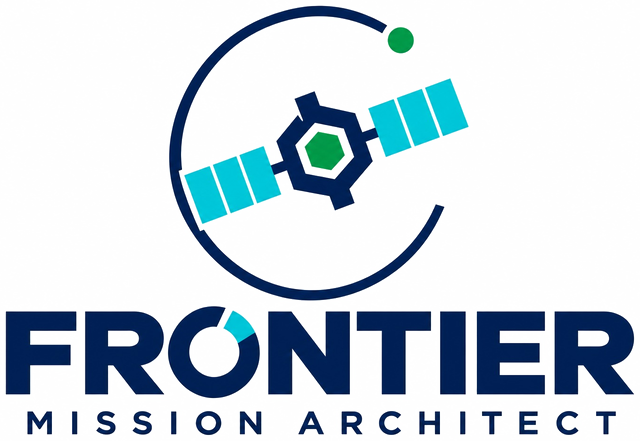
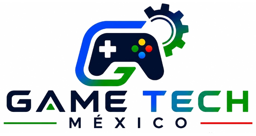

<p align="center"></p>
<p align="center"></p>

# GameTechMx Frontier

Juego de exploración espacial en mundo abierto, pensado para todas las edades (NASA Space Apps 2026). Empiezas en la Tierra, preparas tu nave, despegas y exploras tres mundos:

- **Marte**: maneja el rover, busca muestras, esquiva meteoritos y regresa al módulo.
- **Júpiter**: vuela alrededor del planeta y escanea 4 zonas para completar el mapa de su atmósfera.
- **Miller** (el planeta oceánico de *Interstellar*): navega entre olas gigantes y busca 3 señales de vida.

Se juega con **teclado** (WASD / flechas, Shift, E), **control** (stick, A) o **pantalla táctil** (joystick y botón E). Español e inglés.

## Desarrollo

```bash
npm install
npm run dev        # http://localhost:5173
npm test           # pruebas de la lógica del mundo
npm run build      # build estático (GitHub Pages)
```

Todo está en `client/` (React + TypeScript + Vite + Three.js, estilo low-poly): `src/world/` contiene el mundo de la Tierra y las tres misiones; `src/three/` ruido determinista y geometrías low-poly. Mundo y puntuación son deterministas por semilla y tienen pruebas en `marsWorld.test.ts`.

## Despliegue

GitHub Actions ejecuta pruebas y build en cada push. En `main` publica `client/dist` en GitHub Pages (Settings → Pages → Source: GitHub Actions).

> `docs/` conserva notas del diseño anterior (simulador técnico) y puede estar desactualizado.


## Niveles de dificultad / Difficulty levels

| Nivel | Decisiones | Pruebas antes de despegar | Misión |
|---|---|---|---|
| Fácil | destino + 1 herramienta | ninguna | 3 hallazgos, sin tiempo |
| Medio | + cohete y energía | 1 (combustible) | 4 hallazgos, más peligros |
| Difícil | + presupuesto y hasta 3 instrumentos | 4 (Δv, masa, costo, energía) | 5 hallazgos, 1 evento en el viaje, tiempo límite, combustible limitado en Júpiter |
| Experto | paneles, batería y escudo térmico en números | 7 con márgenes | 6 hallazgos, 2 eventos, poco tiempo, el casco del submarino aguanta menos |

Miller es un océano: el submarino (modelo CAD `sub`) sube y baja (Espacio/Q y C/Z, gatillos del control, botones ▲▼ en touch). El rover en Tierra y Marte es el ensamble CAD `rover_assem`. Los modelos están en `client/public/models/` (convertidos de STEP a GLB de pocos polígonos).

## Roguelite: taller, contratos y enemigos / Roguelite: workshop, contracts and enemies

- **Chatarra y taller.** Cada misión paga chatarra (más si el nivel es difícil o el contrato es arriesgado; si la nave explota se paga la mitad). En el **Taller** (botón en el hangar o al terminar una misión) hay un árbol de mejoras por nave: rover, orbitador de Júpiter, submarino y cohete. Las mejoras tienen requisitos, cuestan más cada nivel, se guardan en `localStorage` (`frontier-meta-v1`) y cambian el aspecto de la nave (visor 3D giratorio). Las del cohete suben Δv, carga y presupuesto de las pruebas y reducen el daño de los eventos.
- **Armas.** Empiezas sin arma: solo esquivas. Con *Láser / Cañón / Torpedos* (R, LB o botón en touch) puedes derrotar enemigos; auto-apunta al más cercano. Más niveles = más daño y recarga rápida.
- **Contratos.** Además de recolectar: reparar antenas/boyas/nodos (mantén E), rescatar una sonda/satélite/cápsula y llevarla a casa (vas más lento), fotografiar (Marte, requiere cámara). Más contratos disponibles en niveles altos; cada uno cambia el peligro y la paga.
- **Enemigos y ladrón.** Bichos (Marte), drones (Júpiter) y peces abisales (Miller); aparecen por oleadas, crecen con el tiempo y en Difícil/Experto hay élites. Un ladrón (mapache espacial / pulpo ladrón) puede robar una muestra, energía o la carga; atrápalo con E o disparándole.
- **Cartas de misión.** Antes de cada misión eliges 1 de 3 cartas temporales; algunas son arriesgadas.
- **Dificultad.** `levels.ts › modsFor` ahora también controla cantidad, velocidad, vida y daño de enemigos, oleadas, probabilidad del ladrón y multiplicador de chatarra.
- Lógica pura con pruebas: `meta.ts`, `combat.ts`, `pois.ts`, `contracts.ts`, `runkit.ts`, `design.ts`.

### Ajustes posteriores
- **Fotos literales.** En el contrato de fotos aparece un visor: hay que acercarse (≤18 m) y girar el rover hasta encuadrar la formación rocosa (~20°); entonces E toma la foto (flash). Si no está encuadrada, no cuenta.
- **Contacto con enemigos.** Se hinchan medio segundo antes de morder, muerden una vez, retroceden, y tienes ~0.9 s de gracia; el borde de pantalla parpadea en rojo al recibir daño.
- **«¿Por qué esta calificación?»** en la pantalla final: desglose punto por punto de la calificación y de la chatarra ganada.
- **Equipo de pago por misión.** Cohete, instrumentos y extras cuestan chatarra y se pagan al despegar, cada misión (la cámara es gratis; siempre queda un fondo mínimo de 30 para poder volar). Las mejoras del taller son permanentes. El dinero se ve siempre arriba a la izquierda.

## Ciencia y fuentes / Science and sources

The **Ciencia y fuentes** button (top right, next to the language button) opens a bilingual screen with one card per game resource: NASA link, the fact or concept used, the screen where it matters, and what was simplified. Data lives in `client/src/world/sources.ts`.

Honesty rule: a figure counts as NASA-backed only if the linked NASA page states it. Everything else is shown as a **game parameter** (instrument mass/cost/power, rocket masses and costs, per-destination Δv, sunlight except Jupiter's ~1/25, event costs, budget). Miller's planet is fiction from the film *Interstellar* and has no NASA link. The parameter lines are built from `design.ts` constants and checked by `sources.test.ts`, so they cannot drift. GameTechMx Frontier is independent and not endorsed by NASA.

## Enemigos que escalan, juegos en la Tierra / Scaling enemies and Earth side games

- **Enemigos por poder / Power-scaled enemies** (`client/src/world/threat.ts`): la fuerza de tu nave (mejoras compradas + arma) sube vida, velocidad y daño de los enemigos y desbloquea variantes: *swarmer* (rápido), *dasher* (embiste) y *brute* (tanque). Nunca hay más de 4 a la vez. / Your ship's power raises enemy HP, speed and damage and unlocks variants; never more than 4 at once.
- **Canchita y monedas / Pitch and coins** (`earthgames.ts`): en la Tierra empuja el balón a la portería (+2 🪙) o recoge las 10 monedas (+1 c/u, +3 por ronda completa). / On Earth, push the ball into the goal or collect the 10 coins.
- **Garage**: botón «Salir» (o Esc) y, si no alcanza para ninguna misión, leyenda para cambiar de dificultad. / Exit button (or Esc) and a switch-difficulty legend when no mission is affordable.
- **Lanzamiento**: el contador y la elevación usan reloj real (ya no se desfasan en pestañas lentas), la llama sigue la cuenta regresiva y no se puede lanzar dos veces. / Launch uses wall-clock time, flame follows the countdown, no double launches.

## Sonido, progreso, logros y jefes / Sound, progress, achievements and bosses

- **Sonido** (`audio.ts`): efectos y música generativa con WebAudio (sin archivos); botón 🔊/🔇 arriba a la derecha, se recuerda la preferencia. / Synth sound effects and a soft generative loop per world; mute button, remembered.
- **Tierra con vida / Living Earth** (`skylife.tsx`, `earthgames.ts`): avionetas y nubes en el cielo, carrera de conos (meta → 5 conos en orden → meta; +3/+6/+10 🪙 según el tiempo) y rampa de acrobacias (+1 🪙 por salto).
- **Progreso y logros / Progress** (`progress.ts`, `progressui.tsx`): botón 🏆 en la Tierra con estadísticas, 13 logros y «Reiniciar partida» (con confirmación).
- **Tarjetas de ciencia descubribles / Discoverable science cards**: jugar desbloquea tarjetas de «Ciencia y fuentes» (📖); las no descubiertas siguen legibles (🔒) y dicen cómo conseguirlas. Una prueba verifica que cada tarjeta tiene forma de descubrirse.
- **Jefes / Bosses**: cada 4.ª misión trae un jefe por mundo (vida ×9, lento, embiste, cuenta como 5 bajas). El garage avisa antes de despegar. Sigue habiendo máximo 4 enemigos a la vez.
- **Ataques de jefe / Boss attacks**: Marte = temblor (anillo en el suelo), Júpiter = tormenta, Miller = ola. Se avisa ~1.2 s antes y solo daña dentro del anillo; barra de vida arriba.
- **Historia / Story**: Ada y Tuerca, la tripulación de la base, cuentan una historia corta por eventos (primera visita, lanzamientos, jefes…) y enlazan a la tarjeta de ciencia relacionada.
- **Reto diario / Daily challenge** (📅): mismo mundo, semilla y equipo para todos cada día (sin mejoras), racha y mejores puntajes **solo locales** (`frontier-daily-v1`), +10 🪙 la primera vez al día.
- **Eventos del viaje / Trip events**: banco de 28 eventos con 2–3 opciones (algunas con 🎲 y probabilidad visible), elegidos al azar según planeta y nivel, con opciones en orden aleatorio y sin repetir los vistos hace poco (1/1/2/3 preguntas por nivel).
- **Tablero de misiones / Mission board** (📋, en la base de cada planeta, antes de salir): 4 trabajos al azar (hasta 2–3 a la vez). Cambian la misión de verdad (más peligros, más enemigos, más gasto de energía…); al cumplirlos pagan chatarra, suben tu reputación ⭐ (abre trabajos mejores) y dejan un bono; al fallar, una penalización.
- **Efectos de la run / Run effects**: bonos y penalizaciones (💨 🔩 💸 🪫 …) que duran varias misiones y se ven en pantalla (`runstate.ts`, guardado en `frontier-run-v1`).
- **Aprende y juega / Learn & play** (🧠): al terminar cada misión, bitácora (qué pasó, qué aprendiste, qué cambia) y un repaso de 2 preguntas de opción múltiple (+🪙 por acierto). Repaso espaciado (cajas de Leitner, `review.ts`): lo que fallas vuelve mañana, lo que aciertas cada vez más tarde. 💡 en la Tierra = ciencia del día (una tarjeta por día, racha) + repaso. Guardado solo en el dispositivo.
- **Ajustes y accesibilidad / Settings** (⚙️): letra grande (A+/A++), alto contraste, sin límite de tiempo, subtítulos de sonido (funcionan aunque esté en silencio) y menos movimiento. Se guardan en el dispositivo.
- **Tripulación y saga**: 6 compañeros (Ada, Tuerca, Nube, Dra. Lupa, Capitán Brisa, Estrella) con una ventaja pasiva cada uno; eliges uno en el tablero de misiones y se desbloquean jugando. La historia tiene 6 capítulos que aparecen como trabajo especial (📖) en el tablero de su planeta; al terminar el capítulo 6 ganas el logro «Fin de la historia» y un banderín nuevo.
- **Mapa de exploración**: cada planeta se divide en celdas; las que recorres se iluminan para siempre en un minimapa del tablero de misiones, con premios de chatarra al 25, 50, 75 y 100 %.
- **Cooperativo en pantalla dividida (⚙️ Ajustes)**: dos jugadores, un vehículo cada uno (rover, nave o submarino) en el mismo mundo y misión, cada uno en su mitad de pantalla. J1: WASD, E, F, R, Shift; J2: flechas, Enter, `.` y `/`, `0` turbo; con dos controles el 1.º es J1 y el 2.º J2. El resultado es del equipo (promedio de puntaje, suma de lo demás). No aplica al reto diario. Los dos vehículos no se ven entre sí: son dos copias del mismo mundo.
- **Aspecto / Looks**: pintura del rover, color del polvo y banderín, desbloqueados con logros (no cambian la dificultad).
- **Pulido / Polish**: estelas de balas, chispas de impacto, polvo del rover y textura granulada del terreno.

## Lobby más lleno y gráficos más pulidos / Fuller lobby and polished graphics

- **Lobby** (`lobby.ts`, `lobbydeco.tsx`): torre de lanzamiento y tanques junto al cohete, granja solar, aerogeneradores, domos habitables, antena parabólica, caminos con piedras y farolas, banderas, trabajadores robot, pájaros, globo aerostático, arbustos y parches de flores (instanciados). Los objetos sólidos bloquean al rover; una prueba verifica que nada tapa monedas, carrera, rampa ni caminos. / Launch tower, solar farm, wind turbines, habitat domes, dish, paths, lamps, flags, worker bots, birds, balloon, bushes and flowers.
- **Llantas que giran / Spinning wheels**: giran según la distancia recorrida (adelante y reversa).
- **Gráficos / Graphics** (`quality.ts`, `polish.tsx`): sombras suaves que siguen a la cámara, sombreado liso y más segmentos en naves, criaturas y props (el terreno y las rocas siguen facetados), viñeta suave. Botón ✨ cicla calidad Baja/Media/Alta (celulares y equipos de ≤4 núcleos arrancan en Baja, sin sombras).
- **Muerte y rescate**: si tu vehículo explota pierdes toda la chatarra, las mejoras y la reputación de la expedición. Puedes pagar una sola vez, ahora mismo, para recuperarlo todo (más de la mitad de tu chatarra más una cuota por mejora; más barato en Fácil y más caro en Experto). Si lo dejas ir, no hay vuelta atrás. Las primeras misiones no arriesgan nada y el reto diario nunca te quita nada.
